


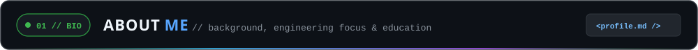

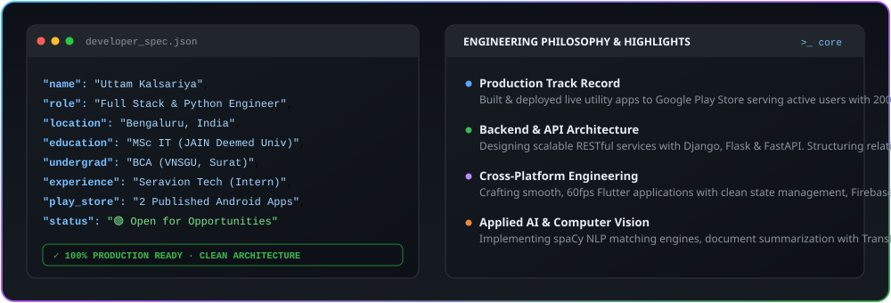

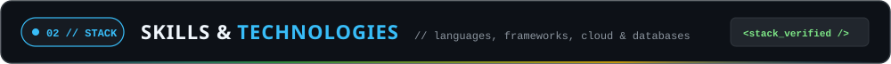

<a href="https://flask.palletsprojects.com/">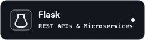</a>
<a href="https://fastapi.tiangolo.com/">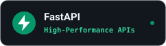</a>

<a href="https://www.mongodb.com/">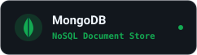</a>
<a href="https://firebase.google.com/">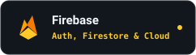</a>
<a href="https://opencv.org/">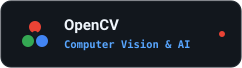</a>

<a href="https://git-scm.com/">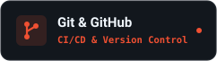</a>

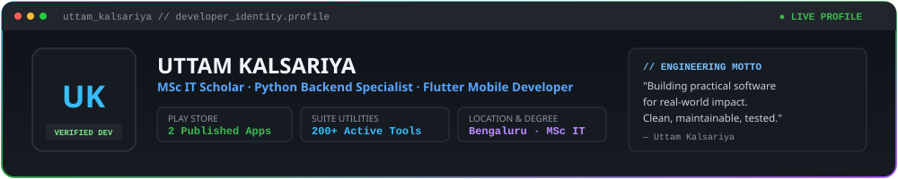

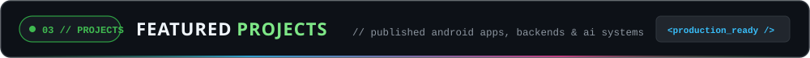

<!-- PROJECTS:START -->

<a href="https://play.google.com/store/apps/details?id=com.aicalculator.chatandtools">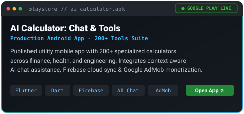</a>
<a href="https://play.google.com/store/apps/details?id=com.BlinkBack.BlinkBack">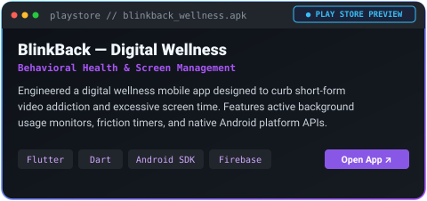</a>
<a href="https://github.com/uttam-kalsariya/JobPortal-AI">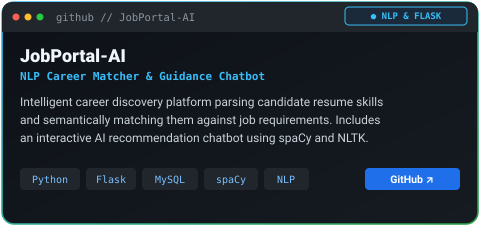</a>
<a href="https://github.com/uttam-kalsariya/Intership_Python/tree/main/Task-4">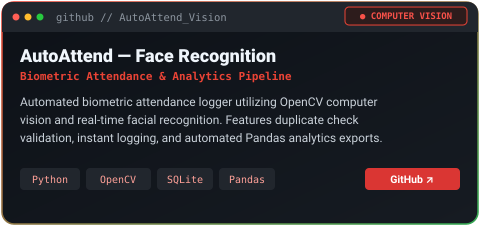</a>
<a href="https://github.com/uttam-kalsariya/summpdf-master">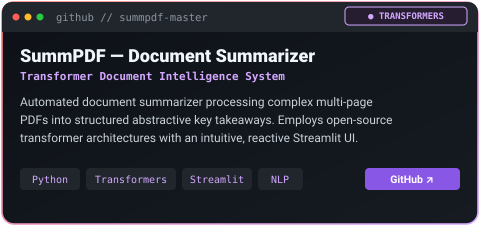</a>
<a href="https://github.com/uttam-kalsariya/Blockchain-Based-Certificate-Verification-System">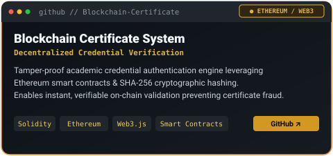</a>

<!-- PROJECTS:END -->

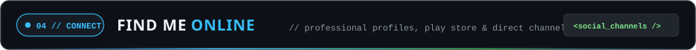

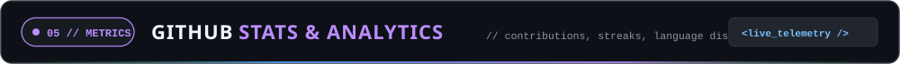

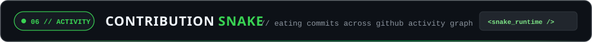

<picture>
  <source media="(prefers-color-scheme: dark)" srcset="https://raw.githubusercontent.com/uttam-kalsariya/uttam-kalsariya/output/github-snake-dark.svg" />
  <source media="(prefers-color-scheme: light)" srcset="https://raw.githubusercontent.com/uttam-kalsariya/uttam-kalsariya/output/github-snake.svg" />
  
</picture>

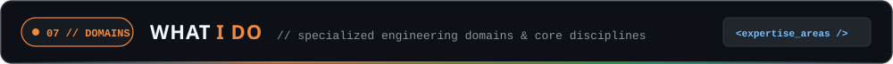

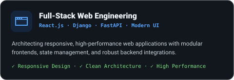

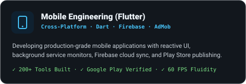
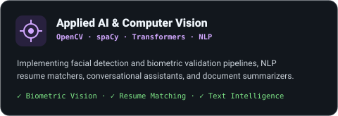

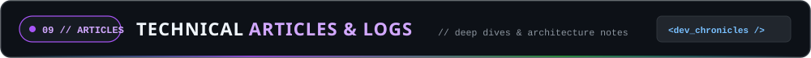

<!-- BLOG:START -->

<a href="https://play.google.com/store/apps/details?id=com.aicalculator.chatandtools">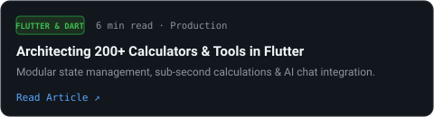</a>
<a href="https://github.com/uttam-kalsariya/JobPortal-AI">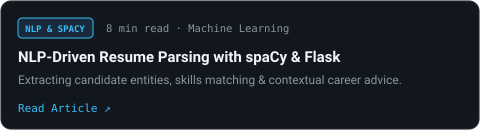</a>
<a href="https://github.com/uttam-kalsariya/Intership_Python/tree/main/Task-4">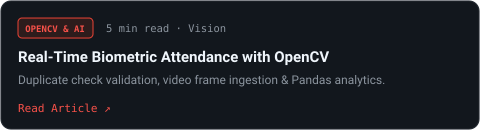</a>
<a href="https://github.com/uttam-kalsariya/Blockchain-Based-Certificate-Verification-System">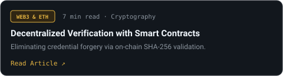</a>

<!-- BLOG:END -->

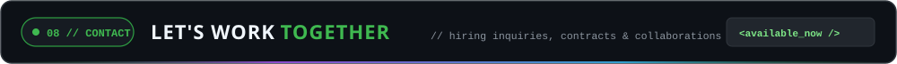

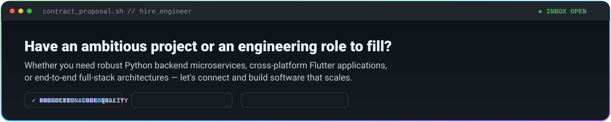

---
🔒 **© 2026 Uttam Kalsariya. All rights reserved.** Full Stack Software Engineer · Python Backend · Flutter Mobile Developer
